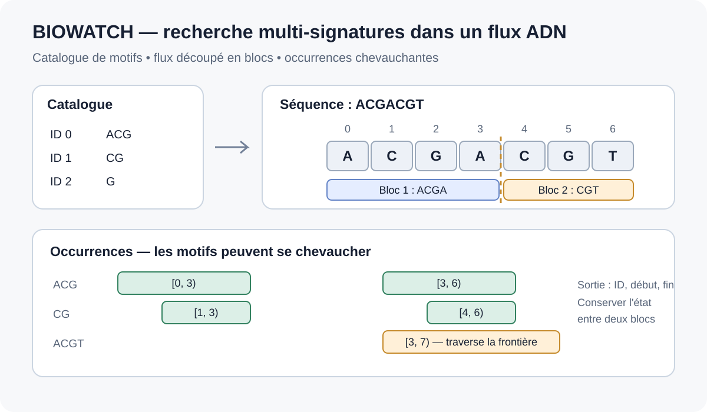

# BIOWATCH — Détection multi-signatures dans des séquences ADN

<small>**Exercice Rust · Intermédiaire à avancé · Algorithmique des chaînes · Automates et streaming**</small>

---

## 1. Le contexte



Un laboratoire de surveillance génomique analyse de longues séquences ADN afin de repérer des signatures connues : motifs associés à des variants, marqueurs de résistance ou séquences d'intérêt pour une étude.

Le laboratoire possède un catalogue de signatures. Chaque signature est une courte séquence composée des nucléotides `A`, `C`, `G` et `T`.

Les séquences à analyser sont beaucoup plus longues que les signatures. Elles arrivent parfois progressivement, par blocs, depuis un séquenceur. Le système ne peut donc pas supposer qu'il recevra toujours une séquence complète en une seule fois.

Une première implémentation compare chaque signature à toutes les positions possibles de la séquence. Elle fonctionne sur de petits échantillons, mais devient trop lente lorsque le catalogue et les séquences grandissent.

Le laboratoire te confie le développement de **BIOWATCH**, un moteur de recherche multi-signatures capable d'analyser un flux ADN sans recommencer son travail à chaque bloc.

## 2. Le problème algorithmique central

Tu dois rechercher simultanément un grand nombre de motifs dans une séquence.

Exemple de catalogue :

| ID | Signature |
|---:|:---|
| 0 | `ACG` |
| 1 | `CG` |
| 2 | `G` |
| 3 | `ACGT` |
| 4 | `CG` |

Séquence à analyser :

```text
ACGACGT
```

Plusieurs signatures peuvent correspondre à des positions qui se chevauchent. Par exemple, à la fin de `ACG`, les motifs `ACG`, `CG` et `G` sont tous présents.

Le motif `CG` est également enregistré deux fois, avec deux identifiants différents. Le moteur doit préserver cette distinction : deux entrées identiques dans le catalogue restent deux signatures enregistrées.

**Ta mission :** construire un moteur qui trouve toutes les occurrences de toutes les signatures, y compris les correspondances chevauchantes, sans effectuer une recherche indépendante complète pour chaque motif.

## 3. Les résultats attendus

Pour la séquence `ACGACGT`, les occurrences sont les suivantes :

| ID | Motif | Début inclusif | Fin exclusive |
|---:|:---|---:|---:|
| 0 | `ACG` | 0 | 3 |
| 1 | `CG` | 1 | 3 |
| 2 | `G` | 2 | 3 |
| 4 | `CG` | 1 | 3 |
| 0 | `ACG` | 3 | 6 |
| 1 | `CG` | 4 | 6 |
| 2 | `G` | 5 | 6 |
| 4 | `CG` | 4 | 6 |
| 3 | `ACGT` | 3 | 7 |

Les positions sont indexées à partir de zéro. Chaque intervalle est de la forme `[début, fin)`.

Les résultats doivent être déterministes : trier les occurrences par position de fin croissante, puis par identifiant de signature croissant.

Exemple de sortie :

```text
BIOWATCH - SCAN REPORT

Sequence length: 7
Registered signatures: 5
Occurrences found: 9

Matches:
  [0, 3)  pattern=0  ACG
  [1, 3)  pattern=1  CG
  [2, 3)  pattern=2  G
  [1, 3)  pattern=4  CG
  [3, 6)  pattern=0  ACG
  [4, 6)  pattern=1  CG
  [5, 6)  pattern=2  G
  [4, 6)  pattern=4  CG
  [3, 7)  pattern=3  ACGT
```

## 4. Le véritable défi algorithmique

Une approche naïve consiste à parcourir la séquence pour chaque motif et à comparer les caractères successifs.

Si le catalogue contient `K` motifs, la séquence contient `N` caractères et la longueur moyenne des motifs est `L`, le coût peut atteindre un ordre de grandeur de `O(K × N × L)`.

Cette approche répète énormément de comparaisons.

Tu dois concevoir une structure qui exploite les préfixes communs entre les signatures et conserve suffisamment d'informations sur les correspondances partielles.

Le moteur devra notamment savoir :

- reconnaître plusieurs signatures partageant le même préfixe ;
- reprendre une recherche après un échec partiel sans recommencer depuis le début ;
- détecter les motifs plus courts qui se terminent au même endroit qu'un motif plus long ;
- conserver son état lorsque la séquence est reçue en plusieurs blocs.

La technique algorithmique recherchée repose sur un automate de recherche multi-motifs et sur des **liens de repli** (*failure links*).

Je ne te donne pas sa construction complète : tu devras retrouver comment ces liens permettent de réutiliser le travail déjà effectué.

<small>Indice de recherche : trie, parcours en largeur, préfixes et suffixes.</small>

## 5. Exigences fonctionnelles

BIOWATCH devra permettre de :

1. Enregistrer un catalogue de signatures avec des identifiants stables.
2. Construire un index de recherche à partir du catalogue.
3. Analyser une séquence complète.
4. Analyser une séquence progressivement, bloc par bloc.
5. Détecter toutes les occurrences, y compris les chevauchements.
6. Préserver les signatures dupliquées avec leurs identifiants respectifs.
7. Fournir les positions de début et de fin de chaque occurrence.
8. Calculer le nombre d'occurrences par signature.
9. Réinitialiser une session d'analyse sans reconstruire l'index.
10. Produire un rapport déterministe.

### Comportement du scanner

Le scanner doit conserver au minimum :

- l'état courant de l'automate ;
- le nombre de caractères déjà consommés ;
- les compteurs d'occurrences de chaque signature, si le mode de comptage est activé.

La frontière entre deux blocs ne doit pas interrompre artificiellement une correspondance.

Par exemple, si la séquence est découpée ainsi :

```text
Bloc 1 : ACGA
Bloc 2 : CGT
```

Le motif `ACGT`, qui commence à la position 3 et se termine à la position 7, doit être détecté normalement.

Le scanner ne doit pas considérer chaque bloc comme une nouvelle séquence indépendante.

## 6. Contraintes techniques

| Élément | Exigence |
|:---|:---|
| Langage | Rust |
| Alphabet | `A`, `C`, `G`, `T` |
| Recherche | Exacte, insensible à la casse |
| Nombre de signatures | Jusqu'à 20 000 |
| Longueur totale du catalogue | Jusqu'à 300 000 caractères |
| Longueur d'une signature | De 1 à 2 000 caractères |
| Longueur d'une séquence | Jusqu'à 10 millions de caractères |
| Taille d'un bloc reçu | De 1 à 4 096 caractères |
| Complexité de recherche visée | `O(N + Z)` |
| Mémoire maximale cible | 256 MiB |
| Identifiants | Stables et distincts |
| Positions | Indexées à partir de zéro |

Avec :

- `N` : nombre total de caractères analysés ;
- `Z` : nombre total d'occurrences effectivement produites.

La construction de l'index doit être linéaire par rapport à la taille totale du catalogue, à un facteur constant près lié à l'alphabet fixe.

### Validation des entrées

- Les minuscules doivent être normalisées en majuscules.
- Tout caractère autre que `A`, `C`, `G` ou `T` doit produire une erreur explicite.
- Une signature vide est interdite.
- Une séquence vide est autorisée.
- Une signature dupliquée doit conserver un identifiant distinct.
- Les positions doivent rester correctes après plusieurs blocs successifs.

**Atomicité d'un bloc :** si un bloc contient un caractère invalide, le scanner doit le rejeter sans modifier son état ni ses compteurs. Tu devras réfléchir à la manière de garantir cette propriété.

### Gestion de la mémoire

Le moteur ne doit pas stocker systématiquement toutes les occurrences dans une collection en mémoire.

Prévois deux modes :

- **Mode détaillé :** transmettre chaque occurrence à un mécanisme de consommation (par exemple un callback), sans obliger le moteur à conserver l'ensemble des résultats.
- **Mode comptage :** calculer le nombre d'occurrences de chaque signature sans construire la liste complète des correspondances.

Les compteurs doivent utiliser un type entier suffisamment large pour éviter les débordements silencieux.

## 7. Organisation du travail

### Phase 1 — Modélisation

- BIO-001 : Définir les types représentant les signatures et leurs identifiants.
- BIO-002 : Définir le contrat de l'API du moteur.
- BIO-003 : Implémenter une première recherche naïve de référence.
- BIO-004 : Écrire les tests des correspondances chevauchantes et des doublons.

### Phase 2 — Structure de recherche

- BIO-005 : Construire un trie à partir du catalogue.
- BIO-006 : Définir les transitions entre états.
- BIO-007 : Étudier et implémenter les liens de repli.
- BIO-008 : Construire les liens de repli avec un parcours en largeur.
- BIO-009 : Gérer les motifs terminaux et les motifs suffixes.

### Phase 3 — Moteur de recherche

- BIO-010 : Implémenter la consommation caractère par caractère.
- BIO-011 : Détecter les correspondances multiples à une même position.
- BIO-012 : Produire les positions exactes des occurrences.
- BIO-013 : Implémenter le mode de comptage.
- BIO-014 : Garantir un ordre de sortie déterministe.

### Phase 4 — Streaming et robustesse

- BIO-015 : Implémenter l'analyse par blocs.
- BIO-016 : Préserver l'état entre deux blocs.
- BIO-017 : Implémenter la réinitialisation d'une session.
- BIO-018 : Gérer les entrées invalides de manière atomique.
- BIO-019 : Vérifier les limites des types numériques.

### Phase 5 — Performance et finalisation

- BIO-020 : Comparer le moteur à la recherche naïve.
- BIO-021 : Mesurer les performances sur de grands catalogues.
- BIO-022 : Mesurer l'utilisation mémoire.
- BIO-023 : Tester les séquences contenant beaucoup de correspondances.
- BIO-024 : Documenter les invariants et les complexités.
- BIO-025 : Finaliser la CLI et les rapports.

## 8. Les cas limites à tester

| Cas | Comportement attendu |
|:---|:---|
| Catalogue vide | Index valide, aucune occurrence |
| Séquence vide | Aucune occurrence |
| Motif d'un seul caractère | Détection normale |
| Plusieurs motifs avec le même préfixe | Toutes les correspondances |
| Motifs imbriqués (`A`, `AC`, `ACG`) | Toutes les correspondances |
| Motifs suffixes (`G`, `CG`, `ACG`) | Toutes les correspondances |
| Motifs identiques avec des IDs différents | Une occurrence par ID |
| Correspondances chevauchantes | Aucune occurrence perdue |
| Motif réparti sur deux blocs | Correspondance détectée |
| Bloc contenant un caractère invalide | Rejet atomique du bloc |
| Réinitialisation | Nouvelle séquence indépendante |
| Longue séquence sans correspondance | Temps de traitement linéaire visé |
| Séquence répétitive (`AAAAAAAA...`) | Toutes les occurrences attendues |

## 9. Objectifs d'apprentissage

À la fin de cet exercice, tu devras être capable de :

- Modéliser un problème de recherche multi-motifs.
- Comprendre pourquoi un trie est adapté aux préfixes communs.
- Construire un automate de recherche.
- Comprendre les liens de repli et leurs invariants.
- Utiliser un parcours en largeur pour construire une structure algorithmique.
- Analyser rigoureusement une complexité `O(N + Z)`.
- Concevoir un traitement de données en streaming.
- Gérer des états persistants entre plusieurs appels.
- Éviter les allocations mémoire inutiles.
- Concevoir une API Rust qui sépare l'index immuable de l'état mutable d'une session.
- Écrire des tests différentiels comparant une implémentation optimisée à une référence naïve.

## 10. Règles de notre exercice

1. Tu ne reçois pas directement la solution algorithmique.
2. Tu commences par analyser le problème et proposer une modélisation.
3. Tu présentes ton raisonnement et ton pseudocode avant l'implémentation.
4. Je challenge les choix algorithmiques et les invariants.
5. Nous examinons les preuves de correction et les complexités.
6. Tu implémentes en Rust et nous évaluons la qualité du code.

**Une règle importante :** ne cherche pas simplement à reproduire un algorithme connu. Je veux que tu comprennes pourquoi chaque transition est correcte, pourquoi certaines correspondances ne doivent pas être perdues et comment l'état peut être conservé entre deux blocs.

---

# Première mission — Analyse et modélisation

Avant d'écrire la moindre ligne de Rust, réponds aux questions suivantes.

### 1. Modélisation

Comment représenterais-tu le catalogue de signatures pour partager les préfixes communs ?

Propose les structures de données Rust qui te semblent adaptées. Précise ce qui doit être partagé entre toutes les recherches et ce qui doit appartenir à une session d'analyse.

### 2. Approche naïve

Décris une méthode simple permettant de rechercher toutes les occurrences de tous les motifs.

Présente son pseudocode et identifie précisément les boucles qui déterminent sa complexité.

### 3. Correspondances chevauchantes

Pourquoi une recherche qui s'arrête dès qu'elle trouve une correspondance peut-elle manquer d'autres signatures ?

Utilise les motifs `A`, `CA`, `ACA` et `G` pour construire un exemple.

### 4. Préfixes et suffixes

Si le moteur vient de lire `ACG`, mais qu'aucun motif complet ne correspond à la suite, quelles informations pourrait-il réutiliser pour continuer la recherche sans revenir au début de la séquence ?

Ne donne pas seulement une intuition : propose une représentation de cet état.

### 5. Streaming

Si un motif commence à la fin d'un bloc et se termine au début du bloc suivant, quelles informations le scanner doit-il absolument conserver ?

Pourquoi conserver uniquement les derniers caractères reçus n'est-il pas nécessairement la meilleure conception ?

### 6. Complexité

Explique ce que signifie `O(N + Z)` dans cet exercice.

Pourquoi ne peut-on pas garantir un temps strictement `O(N)` si le moteur doit effectivement produire toutes les occurrences ?

---

**Livrable de ta première mission :**

- Une proposition de modélisation.
- Les structures de données envisagées.
- Le pseudocode de la solution naïve.
- Une première proposition d'architecture Rust.
- Une analyse de complexité.

Ne commence pas encore l'implémentation de l'automate.

*Le véritable défi de BIOWATCH n'est pas de trouver un motif dans une chaîne. C'est de construire un moteur capable de rechercher des milliers de motifs simultanément, de ne pas perdre les correspondances chevauchantes et de continuer son analyse même lorsque les données arrivent progressivement.*

---

**À toi de jouer.** Présente d'abord ton raisonnement et ton pseudocode. Nous examinerons les choix avant de passer à Rust.
