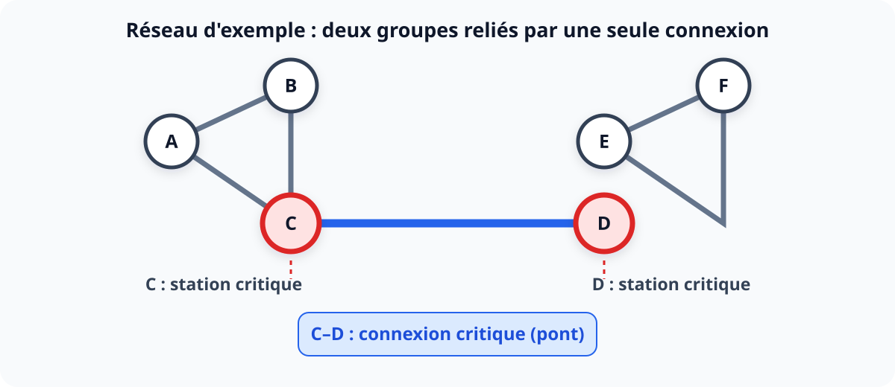

<div align="center">

# NETGUARD
### Moteur d'analyse de résilience des réseaux


</div>


---

## 1. Le contexte

Une entreprise exploite une infrastructure de distribution d'énergie reliant plusieurs villes.

Cette infrastructure est constituée de stations électriques et de lignes de transmission.

Chaque station peut être connectée à plusieurs autres stations. L'ensemble forme un réseau complexe dont la topologie évolue régulièrement : de nouvelles stations sont construites, certaines lignes sont supprimées pour maintenance et d'autres sont ajoutées.

Un problème préoccupe désormais l'équipe d'ingénierie.

Une panne peut provoquer l'isolement d'une partie du réseau. Mais toutes les stations et toutes les lignes ne présentent pas le même niveau de criticité.

Imagine cette situation :

- La station A est reliée à B et C.
- B est reliée à C.
- C est reliée à D.
- D est reliée à E et F.
- E est reliée à F.

Si la ligne entre C et D est détruite, deux parties du réseau deviennent complètement isolées.

En revanche, si la ligne entre A et B est détruite, le réseau reste fonctionnel grâce à une autre connexion.

L'entreprise souhaite donc identifier automatiquement les éléments dont la défaillance pourrait compromettre la connectivité de son infrastructure.

Elle te confie le développement de **NETGUARD**, un moteur d'analyse de résilience des réseaux.

## 2. Le problème algorithmique central

Tu dois identifier deux catégories d'éléments critiques.

### A. Les stations critiques (*Articulation Points*)

Une station est critique si sa suppression, avec toutes ses connexions, augmente le nombre de composantes connexes du réseau.

Autrement dit, sa disparition provoque la séparation de certaines parties du réseau.

### B. Les connexions critiques (*Bridges*)

Une connexion est critique si sa suppression augmente le nombre de composantes connexes du réseau.

C'est précisément le cas de la connexion C–D dans notre exemple.



## 3. Les exigences fonctionnelles

NETGUARD devra permettre de :

1. Créer un réseau avec un ensemble de stations.
2. Ajouter une connexion entre deux stations.
3. Supprimer une connexion.
4. Afficher les stations et connexions du réseau.
5. Analyser la résilience du réseau.
6. Identifier toutes les stations critiques.
7. Identifier toutes les connexions critiques.
8. Générer un rapport d'analyse.

Exemple de résultat attendu pour le graphe A–F décrit plus haut :

```text
NETGUARD - NETWORK ANALYSIS

Network:
  Stations: 6
  Connections: 7

Analysis:
  Critical stations:
    - C
    - D

  Critical connections:
    - C-D

  Connected components: 1

Resilience:
  Critical elements detected.
```

> **Note de cohérence :** le graphe de l'exemple contient bien 7 connexions : A–B, A–C, B–C, C–D, D–E, D–F et E–F.

## 4. Le véritable défi algorithmique

Tu pourrais résoudre naïvement le problème de cette manière :

- Pour chaque station, la supprimer temporairement et recalculer la connectivité.
- Pour chaque connexion, la supprimer temporairement et recalculer la connectivité.

Mais cette approche devient extrêmement coûteuse sur un grand réseau.

Imagine une infrastructure comportant :

- 200 000 stations ;
- 500 000 connexions.

Tu ne peux pas te permettre de recalculer toute la structure pour chaque élément.

**Ta mission : trouver un algorithme capable d'identifier tous les éléments critiques en O(V + E).**

Avec :

- **V** : nombre de stations (sommets).
- **E** : nombre de connexions (arêtes).

L'algorithme que tu vas devoir découvrir et implémenter repose sur une technique appelée **DFS avec Low-Link Values**, notamment utilisée dans l'algorithme de Tarjan.

Je ne te donne volontairement pas encore son fonctionnement. Tu devras comprendre les propriétés mathématiques qui permettent de détecter ces éléments sans supprimer réellement chaque élément.

## 5. Contraintes techniques

| Élément | Exigence |
|---|---|
| Langage | Rust |
| Structure principale | Liste d'adjacence (*Adjacency List*) |
| Graphe | Non orienté |
| Taille | Jusqu'à 200 000 sommets |
| Connexions | Jusqu'à 500 000 arêtes |
| Complexité attendue | O(V + E) |
| Mémoire | O(V + E) |
| Résultats | Déterministes |

### Cas particuliers à gérer

- Réseau composé de plusieurs composantes connexes.
- Station isolée.
- Connexions multiples entre deux stations (*arêtes parallèles*).
- Connexion d'une station avec elle-même (*boucle*).
- Réseau vide.

**Attention :** les connexions multiples rendent certaines implémentations naïves de DFS incorrectes. Tu devras donc réfléchir à la manière d'identifier précisément chaque arête, et pas uniquement son sommet opposé. Chaque connexion devra pouvoir être distinguée par un identifiant unique.

Autre contrainte : avec 200 000 sommets, une DFS récursive classique peut provoquer un débordement de pile. Tu devras envisager une DFS itérative.

## 6. Organisation du travail

### Phase 1 — Modélisation


- **NETGUARD-020** : Définir les structures de données du réseau.
- **NETGUARD-021** : Implémenter les opérations de gestion des stations.
- **NETGUARD-022** : Implémenter les connexions et leur suppression.
- **NETGUARD-023** : Construire et tester la liste d'adjacence.

### Phase 2 — Algorithmique


- **NETGUARD-024** : Étudier le parcours DFS.
- **NETGUARD-025** : Comprendre les valeurs *Discovery Time* et *Low-Link*.
- **NETGUARD-026** : Détecter les stations critiques.
- **NETGUARD-027** : Détecter les connexions critiques.
- **NETGUARD-028** : Implémenter une DFS itérative.

### Phase 3 — Robustesse

- **NETGUARD-029** : Gérer les graphes non connexes.
- **NETGUARD-030** : Gérer les arêtes multiples et les boucles.
- **NETGUARD-031** : Ajouter les tests de propriétés et les cas limites.
- **NETGUARD-032** : Vérifier les performances sur de grands graphes.

### Phase 4 — Finalisation

- **NETGUARD-033** : Générer les rapports d'analyse.
- **NETGUARD-034** : Documenter les invariants algorithmiques.
- **NETGUARD-035** : Finaliser la CLI et la documentation.

## 7. Ce que tu devras maîtriser

À la fin, tu devrais être capable de :

- Modéliser un problème réel avec la théorie des graphes.
- Comprendre et utiliser DFS.
- Comprendre les arbres de parcours et les relations entre sommets.
- Comprendre les notions de *Discovery Time* et *Low-Link*.
- Concevoir un algorithme linéaire O(V + E).
- Éviter les recalculs inutiles.
- Implémenter un parcours itératif avec Rust.
- Justifier mathématiquement la correction et la complexité de ton algorithme.

## 8. Les règles de l'exercice

1. Tu ne reçois pas directement la solution algorithmique.
2. Tu commences par analyser le problème et proposer une modélisation.
3. Tu présentes ton raisonnement et ton pseudocode avant l'implémentation.
4. Ton approche est ensuite challengée, notamment sur les choix algorithmiques.
5. Nous examinons les preuves de correction et les complexités.
6. Tu implémentes en Rust et la qualité du code est évaluée.

> **Règle importante :** l'objectif n'est pas de mémoriser l'algorithme de Tarjan. Il faut comprendre pourquoi il fonctionne et être capable de retrouver une approche similaire face à un autre problème.

---

## 9. Première mission — Analyse du problème

Avant d'écrire la moindre ligne de Rust, réponds à ces trois questions.

### 1. Modélisation

Pourquoi peut-on représenter cette infrastructure avec un graphe non orienté ? Quelles structures de données Rust pourrais-tu utiliser pour représenter ce graphe ?

### 2. Approche naïve

Sans connaître Tarjan, comment pourrais-tu déterminer si une station est critique ? Décris ton raisonnement sous forme de pseudocode.

### 3. Complexité

Si tu devais supprimer temporairement chacune des 200 000 stations et recalculer la connectivité à chaque fois, quels problèmes de performance rencontrerais-tu ?

Nous allons commencer par ces questions. La suite dépendra de la solidité de ton raisonnement.

---

*La difficulté intéressante de cet exercice n'est pas de parcourir un graphe. C'est de découvrir comment extraire, pendant un seul parcours, suffisamment d'informations pour savoir quelles suppressions pourraient déconnecter le réseau.*

<div align="center">

**NETGUARD · Rust Algorithmic Challenge**

</div>
